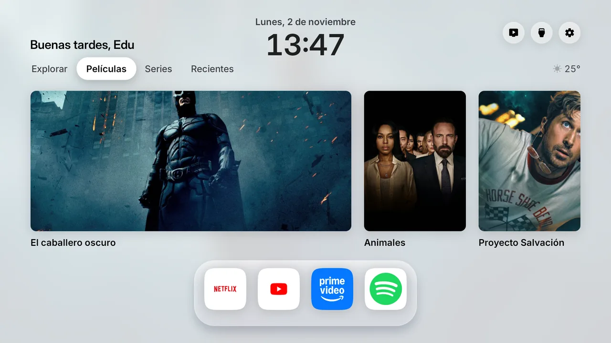
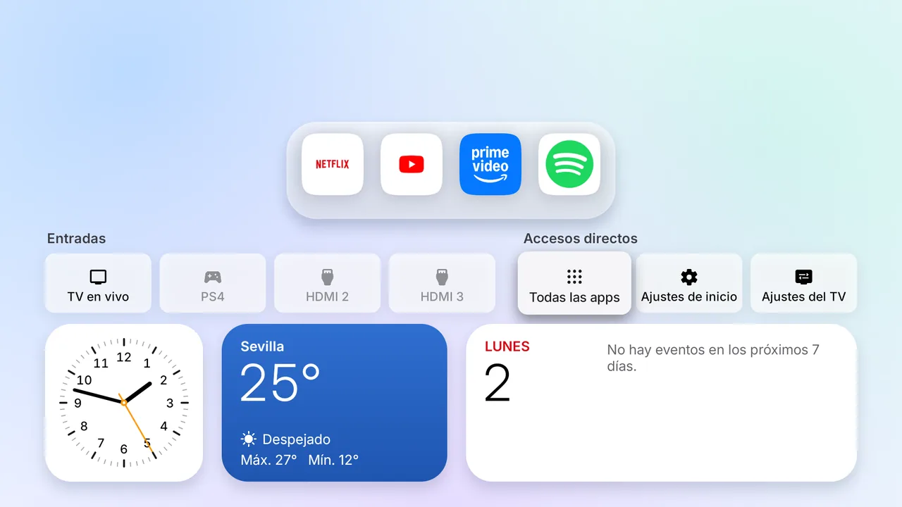
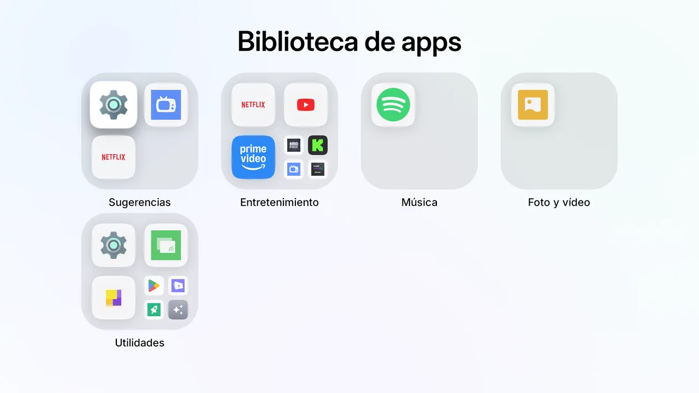
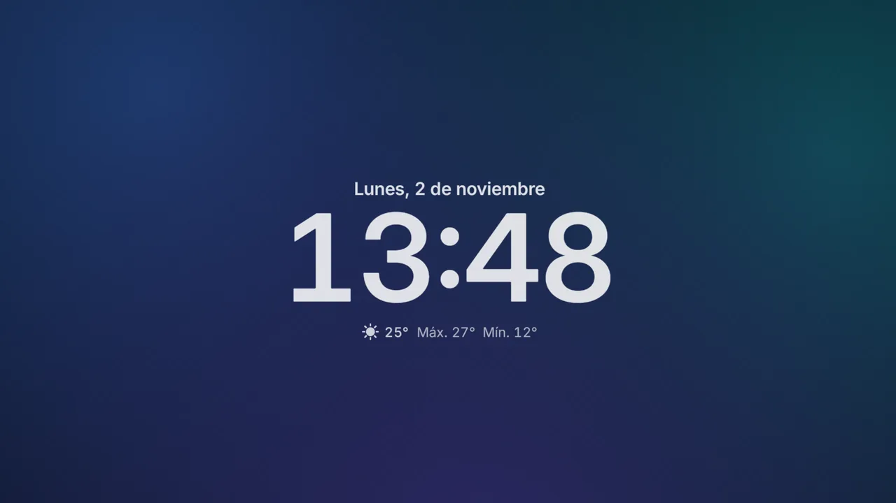

# Free My TV · edición Glass

**Mi pantalla de inicio para Google TV, rediseñada al estilo iOS y tvOS.**

Cristal, iconos squircle, la hora de la pantalla de bloqueo y un fondo que cambia con el sol. 
Mis vídeos de YouTube, mi calendario y mis apps, sin anuncios. Hecho con Claude Code.

> [!NOTE]
> Este repositorio es una versión personal de **[Free My TV](https://github.com/simbasjungles/free-my-tv)**, el proyecto
> original de [simbasjungles](https://github.com/simbasjungles). Todo el mérito de la base (el cambio de pantalla de
> inicio, el modo Original, el vigilante, las versiones para LG y Samsung) es suyo. Si buscas la versión oficial, con
> instalación paso a paso y soporte para más teles, ve allí: [simbasjungles/free-my-tv](https://github.com/simbasjungles/free-my-tv).

Esta edición está adaptada a una Xiaomi MiTV con Google TV (Android 11). Sigue siendo lo que es el original: sin root, sin desinstalar nada y con un botón para volver
a la pantalla de inicio de fábrica.

## Qué cambia respecto al original

- **Diseño "Glass", inspirado en iOS y tvOS.** Materiales de cristal con brillo especular, iconos squircle, los estilos
  de texto de tvOS, colores de iOS con contraste de al menos 4,5:1 y márgenes del 5 %. Todo sale de un sistema de
  diseño en un solo archivo: [`design/glass.html`](design/glass.html).
- **La hora como en la pantalla de bloqueo.** Fecha y hora grandes arriba al centro, en 24 h, y un saludo según la hora.
- **Un fondo que sigue al sol.** Manchas de color para el amanecer, el día, el atardecer y la noche; claro de día y
  oscuro de noche, calculado con la salida y la puesta del sol de tu ciudad.
- **Foco tipo tvOS.** Lo que tiene el foco crece un 8 %, se eleva y brilla; el resto se atenúa. Muelles de 250-350 ms.
- **YouTube en Explorar.** Los 10 vídeos más nuevos de los canales que más ves, sin Shorts. Se conecta con tu cuenta
  de Google mediante un código en el móvil.
- **Películas, Series y Recientes.** Las recomendaciones de TMDB y las últimas apps que has usado.
- **Dock de cristal** con tus 5 apps favoritas; el nombre solo aparece en la que tiene el foco.
- **Widgets de iOS en el cajón.** Reloj analógico, el tiempo de tu ciudad y tu agenda de Google Calendar.
- **Biblioteca de apps** con carpetas por categoría, como en el iPhone.
- **Protector de pantalla** con la hora grande sobre el fondo de la hora del día.
- **Entradas con nombre**: llama a cada HDMI como quieras (por ejemplo, "PS4").
- **Arreglo para Xiaomi.** El botón de Ajustes del mando ya no deja bloqueados los demás botones.

## Capturas

Hechas en la tele (Xiaomi MiTV, Google TV).

<table>
<tr>
<td colspan="2"> <b>Inicio.</b> La hora, el saludo, las pestañas y el dock de cristal.</td>
</tr>
<tr>
<td colspan="2"> <b>Cajón.</b> Entradas con nombre, accesos directos y widgets de reloj, tiempo y agenda.</td>
</tr>
<tr>
<td width="50%"> <b>Biblioteca de apps.</b> Carpetas por categoría, como en el iPhone.</td>
<td width="50%"> <b>Protector de pantalla.</b> La hora grande sobre el fondo del momento del día.</td>
</tr>
</table>

## Ajustes propios

Además de los del original, en `config.properties` (que nunca se sube a git):

| Ajuste | Para qué |
|---|---|
| `user_name` | El nombre del saludo ("Buenas tardes, Edu"). |
| `calendar_ics` | La dirección secreta en iCal de tu Google Calendar, para la agenda. **Es privada.** |
| `youtube_client_id`, `youtube_client_secret` | Un cliente OAuth de Google Cloud del tipo "TVs y dispositivos de entrada limitada", para YouTube. **Privados.** |
| `input_names` | Nombres para las entradas HDMI: `1=PS4, 2=Apple TV`. |
| `custom_font` | La ruta a una fuente propia (`.ttf`/`.otf`) en lugar de Inter. Solo entra en el APK. |
| `idle_pikachu` | Un easter egg personal cuando la tele se queda quieta. Desactivado por defecto. |

## Instalar

Igual que el original: Google TV o Android TV, un ordenador en la misma wifi y unos diez minutos. Sigue las
[instrucciones del proyecto original](https://github.com/simbasjungles/free-my-tv#install), o pídeselo a un asistente
de IA como Claude Code dándole la IP de tu tele y tu ciudad.

Para compilar: `./build.sh`. Guarda bien `freemytv.keystore`: las actualizaciones tienen que firmarse con la misma clave.

## Progreso

- [x] Arreglo del mando en Xiaomi
- [x] Sistema de diseño Glass y rediseño de inicio, dock, cajón, biblioteca de apps, ajustes y protector
- [x] YouTube, calendario, apps recientes y entradas con nombre
- [ ] Comprobar de nuevo la vuelta al modo Original
- [ ] Medir que todo va a 60 fps en la tele
- [ ] Publicar la app de Google Cloud para que YouTube no caduque cada 7 días

## Créditos y licencia

- **Proyecto original:** [Free My TV](https://github.com/simbasjungles/free-my-tv), de
  [simbasjungles](https://github.com/simbasjungles) y sus colaboradores, con licencia [MIT](LICENSE), que se mantiene
  en este fork. Su web: [freemytv.io](https://freemytv.io).
- **Esta edición:** el diseño Glass y los cambios de arriba, por [eduballesteros](https://github.com/eduballesteros),
  hechos con Claude Code.
- **Recursos:** iconos de interfaz Material Symbols (Apache 2.0), fuente Inter (SIL OFL) y películas y series de
  [TMDB](https://www.themoviedb.org); este producto usa la API de TMDB, pero TMDB no lo respalda ni lo certifica.
  Los logotipos de las apps son de sus dueños.
